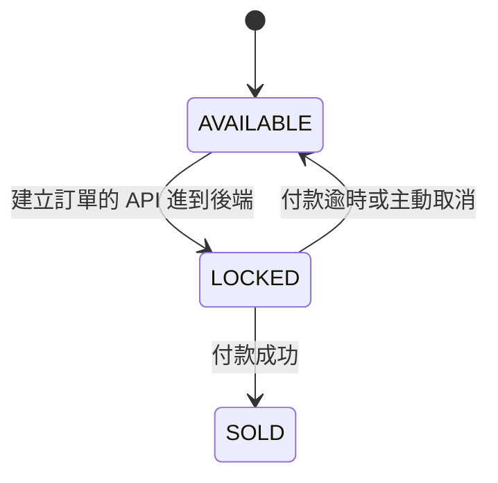
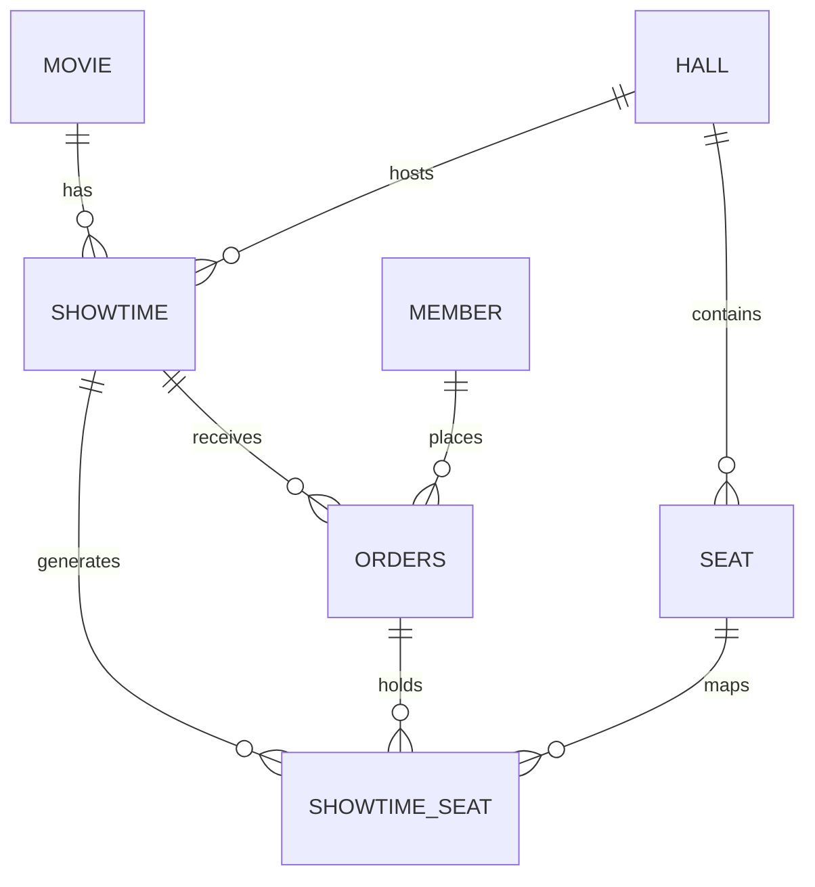

# movie-ticket-booking 系統設計

> 討論日期：2026-11-12
> 白板：<https://excalidraw.com/#room=40378eb501cb96f98f2e,YbesiWVIyuYRNJr9gAiYNQ>
> 尚未定案與尚未討論的項目見 `open-items.md`。

## 1. 專案目標與範圍

練習高併發情境的電影訂票系統，影城專門放映動畫電影。學習專案，分兩個階段：

- **階段一（MVP）**：用 Spring Boot + React + PostgreSQL 完成可運作的訂票系統，以資料庫層的機制保證不超賣。
- **階段二**：用壓測找出瓶頸，逐步演進架構（限流 → Redis → MQ），記錄每次改動前後的數據。

設計原則：MVP 用最簡單、正確的做法，不預先引入 Redis 或 MQ；但在程式結構上保留之後加入的彈性。

### MVP 範圍

| 模組 | 納入 | 先不做 |
|---|---|---|
| 會員 | 註冊、登入、JWT 驗證、USER／ADMIN 兩種角色 | 第三方登入、忘記密碼信件 |
| 電影 | 列表、詳情（海報、簡介、導演、片長、分級、上映日） | 搜尋、評論、推薦 |
| 影廳與場次 | 管理員建立影廳、排場次 | 多家影城、動態票價 |
| 訂票 | 選場次 → 選位 → 鎖位 15 分鐘 → 模擬付款 → 訂單成立；逾時自動釋放 | 真實金流、退票、學生票等多票種 |
| 訂單 | 我的訂單、訂單詳情 | 電子票 QR code、通知信 |

## 2. 訂票流程

座位（某場次的某座位）的狀態轉換：



- **鎖位時機**：建立訂單的請求一進後端就鎖位，不是等付款。前端「點選座位但尚未送出」只是畫面上的選取，不算鎖位。
- **畫面只有兩種狀態**：可選（available）與不可選（unavailable）。鎖住和售出用同一種樣式（變暗），不讓外部從畫面或 API 回應推測座位是被鎖住還是已售出。資料庫內部仍保留三種狀態。
- **訂單狀態**：`PENDING`（待付款）→ `PAID`（已付款），或 `PENDING` → `CANCELLED`（逾時或主動取消）。MVP 不做退票，`PAID` 是終點。

## 3. 訂票運作規則

1. 同一場次的同一座位，任何時刻最多只屬於一筆有效訂單（待付款或已付款）。
2. 一筆訂單多個座位時「全有或全無」：任何一個座位鎖不到，整筆失敗。
   - 單筆訂單最多 4 個座位。
   - 每位會員每場次最多 1 筆有效訂單（待付款或已付款）。付款後不能加購，等於每人每場最多 4 席。取消或逾時的訂單不計入，所以逾時後可以重新訂。
3. 付款時要再次確認鎖位仍有效，避免「逾時釋放」與「付款」同時發生造成衝突。
4. 訂單保留時間 15 分鐘，以後端收到請求的時間起算。
5. 場次開演前 15 分鐘停止售票。停售時間 ≥ 訂單保留時間，所以所有訂單都會在開演前到期。
6. 選位下單只開放給已登入的會員；未登入可以瀏覽電影與座位圖。

## 4. 領域模型與資料表



| 資料表 | 欄位 | 約束與說明 |
|---|---|---|
| `movie` 電影 | id, title, director, duration_min, rating, release_date, poster_url, synopsis | |
| `hall` 影廳 | id, name, layout | `layout` 記錄走道排法（目前皆為 2-6-2） |
| `seat` 座位 | id, hall_id, row_label, seat_no, code | 影廳的固定配置；`code` 如 `A-01`，建立影廳時產生；UNIQUE(hall_id, row_label, seat_no) |
| `showtime` 場次 | id, movie_id, hall_id, start_time, price | 每場次單一票價 |
| `showtime_seat` 場次座位 | id, showtime_id, seat_id, status, order_id | status：AVAILABLE／LOCKED／SOLD；order_id 可為空；UNIQUE(showtime_id, seat_id) |
| `member` 會員 | id, email, password_hash, role | email UNIQUE；role：USER／ADMIN |
| `orders` 訂單 | id, member_id, showtime_id, status, total_amount, expires_at, created_at | status：PENDING／PAID／CANCELLED；有效訂單唯一索引（見下） |

影廳配置：目前所有影廳固定為 10 排（A–J）× 每排 10 個座位，走道 2-6-2，共 100 席。

### 設計重點

1. **座位分兩層**：`seat` 是影廳的固定配置；`showtime_seat` 是「某場次的某座位」，座位狀態都放在這裡。
2. **預先產生場次座位**：管理員建立場次時，為該影廳每個座位產生一列 `showtime_seat`（AVAILABLE）。訂票是更新既有的列，而不是新增列。
   - 選擇理由：和狀態流程一對一對應；查座位圖是單表查詢；階段二接 Redis 或比較鎖機制時，「一個座位＝一列」可以直接沿用。
   - 成本：一場 100 列，資料量很小。真正的負擔來自併發（鎖競爭、座位圖重複查詢、連線數），這在另一種做法（只記錄已訂座位）也一樣存在。
3. **MVP 防超賣**：在同一個交易內執行條件更新，更新列數不等於請求座位數就 rollback。

   ```sql
   UPDATE showtime_seat
   SET status = 'LOCKED', order_id = ?
   WHERE id IN (...) AND showtime_id = ? AND status = 'AVAILABLE';
   ```

4. **每位會員每場次一筆有效訂單**：用 partial unique index 在資料庫層保證；單筆最多 4 席由後端 API 檢查。

   ```sql
   CREATE UNIQUE INDEX ON orders (member_id, showtime_id)
   WHERE status IN ('PENDING', 'PAID');
   ```

## 5. 系統架構

MVP：瀏覽器（React SPA）→ Nginx（API 入口）→ Spring Boot API Server → PostgreSQL

| 元件 | 職責 |
|---|---|
| Nginx | 唯一對外入口（80/443）；提供 React 靜態檔；把 `/api/*` 轉發到後端；階段二加限流 |
| Spring Boot API Server | 驗證 JWT、業務邏輯、交易與鎖位；不對外公開連接埠 |
| PostgreSQL | 訂單與座位歸屬的最終依據；只接受後端連線 |

- 以 Docker Compose 一次啟動，Spring Boot 與 PostgreSQL 只在內部網路。
- 入口層選 Nginx 而非 Spring Cloud Gateway：目前只有一個後端服務，Nginx 設定最少即可達到「請求不直接打到後端」。

### 後端：模組化單體（不採用微服務）

同一個 Spring Boot 專案內分四個模組，模組之間只透過 Service 介面呼叫，不直接存取對方的資料表。

| 模組 | 職責 |
|---|---|
| `member` | 註冊、登入、JWT |
| `movie` | 電影資料 |
| `showtime` | 影廳、座位配置、場次 |
| `booking` | 選位鎖位、訂單、付款、逾時釋放 |

不採用微服務的理由：鎖位與建立訂單在單體內是一個資料庫交易；拆成服務後需要處理分散式交易，會把時間花在基礎設施而不是併發與一致性。模組邊界切清楚，日後仍可把訂票模組拆出去。

### 階段二演進路線

每一步都先壓測、再加入、再比較數據。

1. **Nginx 限流**。
2. **Redis**：座位圖快取（讀）；搶位守門（先在 Redis 做原子判斷，搶到的請求才進資料庫）。
3. **MQ + 訂單 Worker**：訂票 API 把請求放進佇列後回覆處理中，Worker 依序鎖位並寫入資料庫。MQ 位在後端內部（API 與 Worker 之間），不是在 Nginx 與後端之間。

原則：資料庫永遠是最終依據，快取只做加速與守門。不採用「先寫快取、定期同步回資料庫」（write-behind），因為同步前快取當機會遺失訂單，且訂單需要交易保證。資料庫的唯一約束與狀態檢查保留作為最後一道防線。

保留彈性的做法：訂票入口設計成介面（`BookingService.createOrder`）。MVP 的實作是同步寫資料庫；階段二換成經由 MQ 處理時，Controller 與其他模組不用改。

## 6. API 設計

路徑前綴 `/api/v1`。

### 公開（不需登入）

| 方法 | 路徑 | 說明 |
|---|---|---|
| GET | `/movies` | 電影列表 |
| GET | `/movies/{id}` | 電影詳情 |
| GET | `/movies/{id}/showtimes` | 該電影的場次 |
| GET | `/showtimes/{id}/seats` | 座位圖 |
| POST | `/auth/register` | 註冊 |
| POST | `/auth/login` | 登入，回傳 JWT |

### 會員（需要 JWT）

| 方法 | 路徑 | 說明 |
|---|---|---|
| GET | `/members/me` | 我的資料 |
| POST | `/orders` | 建立訂單＋鎖位，body：`{ showtimeId, seatIds[] }` |
| GET | `/orders` | 我的訂單 |
| GET | `/orders/{id}` | 訂單詳情（含狀態、expiresAt） |
| POST | `/orders/{id}/pay` | 模擬付款 |
| POST | `/orders/{id}/cancel` | 主動取消 |

### 管理員（需要 ADMIN）

| 方法 | 路徑 | 說明 |
|---|---|---|
| POST | `/admin/movies` | 新增電影（`PUT /admin/movies/{id}` 修改） |
| POST | `/admin/halls` | 新增影廳與座位配置 |
| POST | `/admin/showtimes` | 新增場次，同時預先產生 `showtime_seat` |

### `POST /orders` 的回應

| 狀態碼 | 情況 |
|---|---|
| 201 | 成功：`{ orderId, status: PENDING, expiresAt, seats, totalAmount }` |
| 400 | 座位數超過 4，或座位不屬於該場次 |
| 401 | 未登入 |
| 409 `SEAT_UNAVAILABLE` | 有座位已被選走；整筆失敗，前端重新載入座位圖 |
| 409 `ACTIVE_ORDER_EXISTS` | 這個場次已有有效訂單；回傳既有的 orderId |
| 422 | 場次已停售（開演前 15 分鐘） |

### 座位圖回應格式

```json
{
  "showtimeId": 12,
  "hall": { "name": "A 廳", "rows": ["A", "B", "...", "J"], "layout": [2, 6, 2] },
  "seats": [
    { "id": 3401, "code": "A-01", "row": "A", "number": 1, "available": true },
    { "id": 3402, "code": "A-02", "row": "A", "number": 2, "available": false }
  ]
}
```

- `id` 是 `showtime_seat` 的 id，下單時 `seatIds` 帶這個；後端檢查它們都屬於該場次。
- `layout` 讓前端知道走道位置，前端不寫死排法。
- 每個座位只有 `available` 布林值，不回傳 LOCKED／SOLD，也不回傳訂位者。

### 設計決策

| 編號 | 問題 | 決定 | 理由 |
|---|---|---|---|
| T1 | 鎖位和建立訂單要一支還是兩支 API | 合一（`POST /orders`） | 一個請求、一個交易，狀態最少；單一票價下保留與下單之間沒有額外步驟 |
| T2 | 重複送出（連點、逾時重試） | 靠「每場次一筆有效訂單」的唯一索引，回 409 並附上既有訂單 | 不需要額外的 Idempotency-Key 機制 |
| T3 | 付款、取消的端點形式 | 動作端點（`POST /orders/{id}/pay`） | 訂單狀態是有規則的狀態機，由後端掌控轉換 |
| T4 | 座位圖如何更新 | MVP 只在載入時查，收到 409 再重查 | 最簡單；輪詢或推送留到階段二與快取一起評估 |

## 7. 訂單逾時機制

1. 建立訂單時由後端寫入 `expires_at = 後端收到請求的時間 + 15 分鐘`（做成設定值）。
2. 是否逾時只以後端時間為準；前端的倒數計時只是顯示，用回應裡的 `expiresAt` 計算。
3. 排程每分鐘執行，把過期的待付款訂單改為已取消，並在同一個交易內把座位改回 AVAILABLE。

   ```sql
   UPDATE orders SET status = 'CANCELLED'
   WHERE status = 'PENDING' AND expires_at < now();
   ```

4. 付款用條件更新，更新 0 列代表已逾時，付款失敗。

   ```sql
   UPDATE orders SET status = 'PAID'
   WHERE id = ? AND status = 'PENDING' AND expires_at > now();
   ```

5. 付款和排程都以 `status = 'PENDING'` 為條件，同一筆訂單只有一方會成功，不會出現「已付款又被釋放」。
6. 權衡：排程每分鐘跑一次，座位最慢會晚 1 分鐘釋放；這段時間別人選不到，但不會出錯。